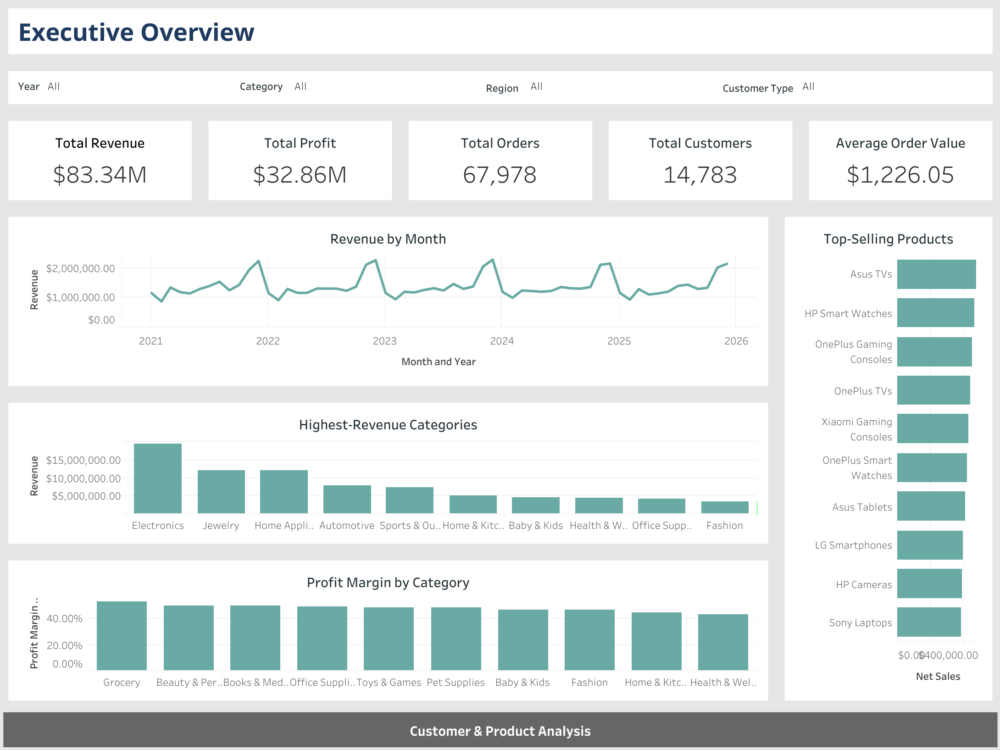
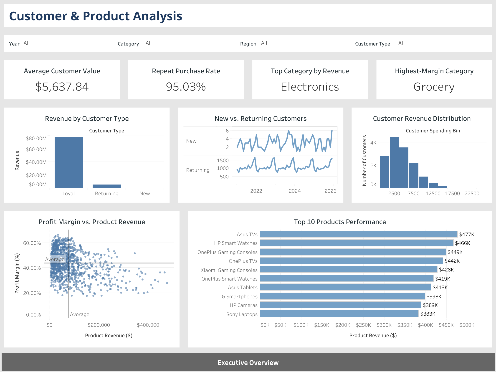

# E-Commerce Sales & Customer Analysis

## Project Overview

This project analyzes e-commerce sales transactions, customer purchasing behavior, product performance, and profitability from 2021 through 2025. The objective is to identify trends, evaluate business performance, and develop data-driven recommendations to support revenue growth, customer retention, and profitability.

The project combines Python for exploratory data analysis, SQL for querying and analyzing transactional data, and Tableau for interactive data visualization. Findings are consolidated into a final analytical report highlighting key insights and business recommendations.

## Business Objectives
- Evaluate sales performance and identify revenue trends.

- Analyze customer purchasing behavior and revenue contributions.

- Identify top-performing products and product categories.

- Examine profitability and the relationship between discounts and profit margins.

- Develop actionable recommendations based on analytical findings.


## Tools & Technologies

| Technology | Tools & Libraries | Application |
|------------|-------------------|-------------|
| Python | pandas, NumPy, Matplotlib | Data validation, exploratory data analysis, and visualization |
| SQL | MySQL, MySQL Workbench | Data validation, joins, aggregations, and analytical queries |
| Tableau | Tableau Public | Interactive dashboards and KPI visualization |
| Jupyter Notebook | Visual Studio Code, Jupyter | Python development and exploratory analysis |
| Version Control | Git, GitHub, Git LFS | Project organization, version control, and file management |


## Dataset Overview

This project uses three interconnected e-commerce datasets containing sales transactions, order-level product details, and product information from 2021 through 2025.

| Dataset | Records | Description |
|---------|---------|-------------|
| Sales | 138,116 | Order transactions, customer information, sales channels, and financial performance |
| Order Items | 397,569 | Individual products purchased within each order, including quantities, pricing, and costs |
| Product Catalog | 1,175 | Product categories, subcategories, brands, suppliers, and product information |

### Analysis Scope

The primary financial analysis focuses on **67,978 completed USD orders** to maintain consistency across financial calculations and comparisons.

The analysis examines revenue trends, customer purchasing behavior, product performance, and profitability over the five-year period.

### Data Validation & Limitations

Data validation included checking missing values, duplicate records, and relationships between the three datasets.

Financial reconciliation identified discrepancies between the Sales and Order Items datasets. To maintain consistency:

- **Sales data** serves as the primary source for order-level financial metrics and customer analysis.
- **Order Items data** supports product-level and category-level analysis.
- **Product Catalog data** provides additional product classifications and attributes.

These differences are considered when interpreting results and comparing metrics across datasets.

Additional details about data preparation, analytical methodology, and limitations are documented in the [Final Analytical Report](05_report/Ecommerce_Sales_Customer_Analytics_Report.pdf).


## Project Components

### Python — Exploratory Data Analysis
Performed data inspection, validation, preparation, and exploratory analysis using pandas, Matplotlib, and Seaborn.

The analysis examines sales performance, customer purchasing behavior, product profitability, and discount patterns.

**Status:** Completed

[View Python Notebook](03_python/ecommerce_eda.ipynb)

### SQL — Data Analysis
Developed MySQL queries to validate datasets and analyze sales transactions, customer behavior, product performance, and profitability using joins, aggregations, and analytical functions.

**Status:** Completed

[View SQL Scripts](02_sql/)

### Tableau — Interactive Dashboards
Developed two Tableau dashboards to visualize business performance and support data-driven decision-making.

- **Executive Overview:** Revenue, profit, orders, average order value, sales trends, and customer performance.
- **Customer & Product Analysis:** Customer purchasing behavior, customer segments, product categories, and profitability.

**Status:** Completed

[View Tableau Workbook](04_dashboard/ecommerce_analytics_dashboard.twbx)

### Final Analytical Report
Prepared a comprehensive analytical report consolidating findings from Python, SQL, and Tableau. The report presents key insights, discusses data limitations, and provides actionable business recommendations.

**Status:** Completed

[View Final Analytical Report](05_report/Ecommerce_Sales_Customer_Analytics_Report.pdf)


## Dashboard Previews

Two Tableau dashboards were developed to present key performance indicators, identify business trends, and explore customer and product performance.

### Executive Overview



The Executive Overview dashboard highlights revenue, profit, order volume, average order value, sales trends, and customer performance.

### Customer & Product Analysis



The Customer & Product Analysis dashboard examines purchasing behavior, customer segments, product-category performance, and profitability.

[Download Tableau Workbook](04_dashboard/ecommerce_analytics_dashboard.twbx)


## Key Findings

The analysis of 67,978 completed USD orders from 2021 through 2025 identified several insights into sales performance, customer behavior, product performance, and profitability.

- **Sales Performance:** Generated $83.34 million in net sales and $32.86 million in profit, representing an overall profit margin of 39.43%.

- **Customer Retention:** Repeat customers accounted for 95.03% of the analyzed customer base, highlighting the importance of retaining existing customers.

- **Customer Segmentation:** Loyal customers contributed 93.94% of total net sales, demonstrating their significant contribution to overall revenue.

- **Product Performance:** Electronics generated the highest product-category revenue at $19.34 million, while Grocery achieved the highest profit margin at 52.65%.

- **Discounts & Profitability:** Higher discount amounts were associated with lower profit margins, particularly during November and December, suggesting opportunities to optimize promotional strategies.

These findings support recommendations focused on customer retention, product-category optimization, and more effective discount strategies.

For detailed analysis, methodology, limitations, and business recommendations, see the [Final Analytical Report](05_report/Ecommerce_Sales_Customer_Analytics_Report.pdf).


## Repository Structure

The repository is organized into six folders representing the major components of the analysis.

```text
ecommerce-sales-analysis/
│
├── 01_data/
│   ├── ecommerce_sales_customer_analytics.csv
│   ├── order_items.csv
│   └── product_catalog.csv
│
├── 02_sql/
│   ├── 01_data_validation.sql
│   ├── 02_sales_analysis.sql
│   ├── 03_product_analysis.sql
│   ├── 04_customer_analysis.sql
│   └── 05_profitability_analysis.sql
│
├── 03_python/
│   └── ecommerce_eda.ipynb
│
├── 04_dashboard/
│   └── ecommerce_analytics_dashboard.twbx
│
├── 05_report/
│   └── Ecommerce_Sales_Customer_Analytics_Report.pdf
│
├── 06_images/
│   ├── executive_overview.png
│   └── customer_product_analysis.png
│
├── README.md
├── requirements.txt
├── .gitignore
└── .gitattributes
```


## Running the Python Analysis
To reproduce the exploratory data analysis:

1. Clone this repository to your local computer.
2. Install the required Python packages using:

   ```bash
   python -m pip install -r requirements.txt
   ```

3. Open `03_python/ecommerce_eda.ipynb` in Jupyter Notebook or Visual Studio Code.
4. Ensure the three source CSV files are available in the `01_data/` directory.
5. Run all notebook cells in sequence.

The analysis uses completed USD orders from 2021–2025 for consistent financial comparisons.


## Author

**Alexis Ohree**

Data analytics professional with a background in communications, marketing, and business operations. Skilled in Python, SQL, Tableau, and data visualization, with a focus on transforming complex datasets into actionable business insights.

This project demonstrates practical experience in data validation, exploratory data analysis, SQL querying, dashboard development, and analytical reporting.

[GitHub Profile](https://github.com/lexohree)

